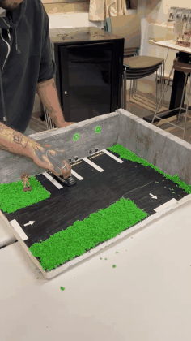
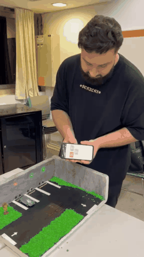

# Estacionamento Inteligente

Projeto acadêmico desenvolvido em grupo para representar o monitoramento de vagas de um estacionamento, combinando uma maquete física, sensores, Arduino e um painel web.

## Objetivo

Apresentar visualmente vagas livres e ocupadas e, na etapa de integração, conectar as leituras dos sensores a um painel de acompanhamento.

## Demonstrações

### Maquete do estacionamento

### Arduino e sensores

### Painel de acompanhamento

## Tecnologias previstas

- HTML, CSS e JavaScript
- Arduino e sensores eletrônicos

## Estado do projeto

O firmware para ESP32 está disponível em [`estacionamento_inteligente.ino`](estacionamento_inteligente.ino). Ele lê os sensores, controla os LEDs e disponibiliza um painel web e a rota `/status` pela rede Wi-Fi criada pelo próprio ESP32. A validação da montagem e da integração física deve ser feita com o hardware do projeto. O GIF do painel é uma demonstração visual e não representa, por si só, uma integração em tempo real.

## Desenvolvimento

Projeto acadêmico colaborativo. A documentação será atualizada conforme o grupo entregar e revisar as próximas partes.

## Vídeo completo do projeto

[Assistir ao vídeo completo no YouTube](https://youtu.be/ddZB8dYenuE)
