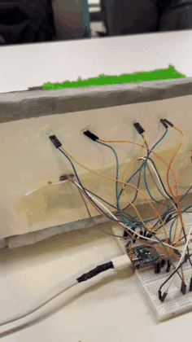

# Estacionamento Inteligente

Projeto acadêmico desenvolvido em grupo para representar o monitoramento de vagas de um estacionamento, combinando uma maquete física, sensores, Arduino e um painel web.

## Objetivo

Apresentar visualmente vagas livres e ocupadas e, na etapa de integração, conectar as leituras dos sensores a um painel de acompanhamento.

## Demonstrações

### Maquete do estacionamento

### Arduino e sensores

### Painel de acompanhamento

## Tecnologias previstas

- HTML, CSS e JavaScript
- Arduino e sensores eletrônicos

## Estado do projeto

O protótipo visual e estas demonstrações já podem ser consultados. O código Arduino, o serviço que fornecerá o estado das vagas em `/status` e a integração completa entre hardware e painel serão adicionados depois que o grupo compartilhar e validar os arquivos. O GIF do painel é uma demonstração visual e não representa, por si só, uma integração em tempo real.

## Desenvolvimento

Projeto acadêmico colaborativo. A documentação será atualizada conforme o grupo entregar e revisar as próximas partes.
